## 모아과

 

**대학 본부, 학과, 학생자치단체**에 흩어진 가톨릭대학교 학내 공지를 한곳에 모아, 필요한 소식과 일정을 놓치지 않도록 돕는 **학내 통합 공지 플랫폼**  
2026 컴퓨터정보공학부 학술제 4팀 YHJ 출품작

🔗 [모아과 바로가기](https://moagwa.zruor.cc)

 

## 목차
- [화면](#화면)
- [주요 기능](#주요-기능)
- [아키텍처](#아키텍처)
- [기술 스택](#기술-스택)
- [저장소](#저장소)
- [팀원](#팀원)

 

## 화면

### 학생

| 홈 | 공지 탐색 | 공지 상세 | 일정 |
|:-:|:-:|:-:|:-:|
| 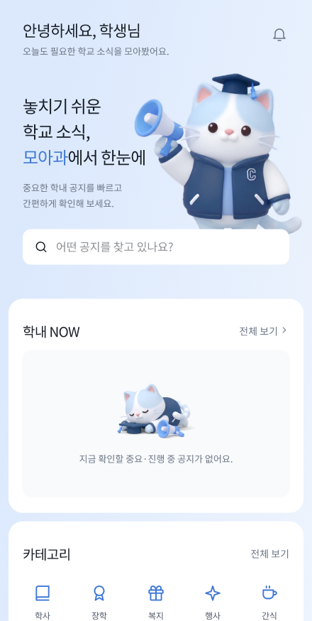 | 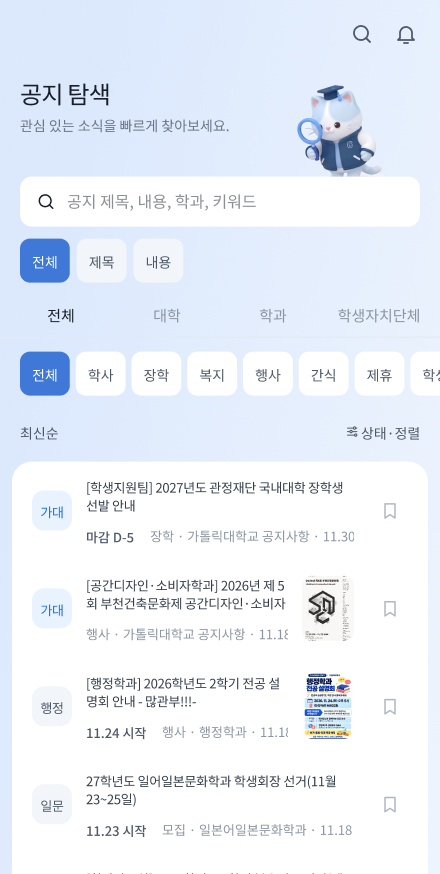 | 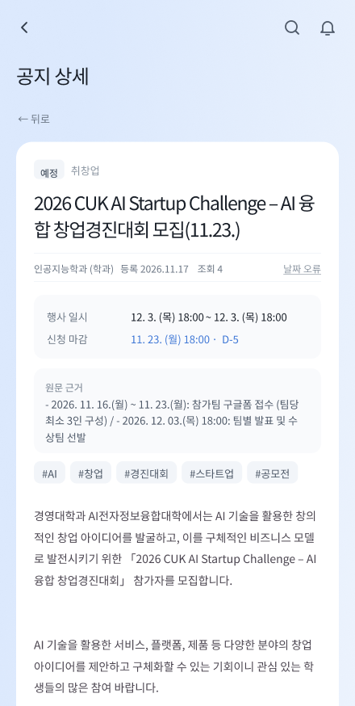 | 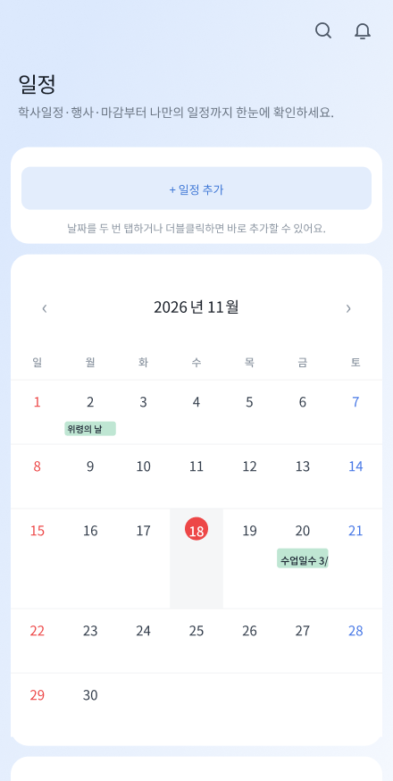 |

| 생활 거래 | 같이 사기 | 채팅 | 알림 |
|:-:|:-:|:-:|:-:|
| 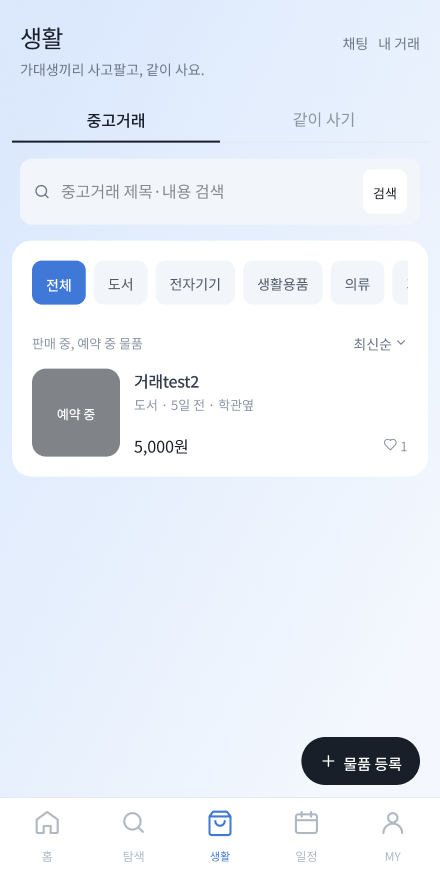 | 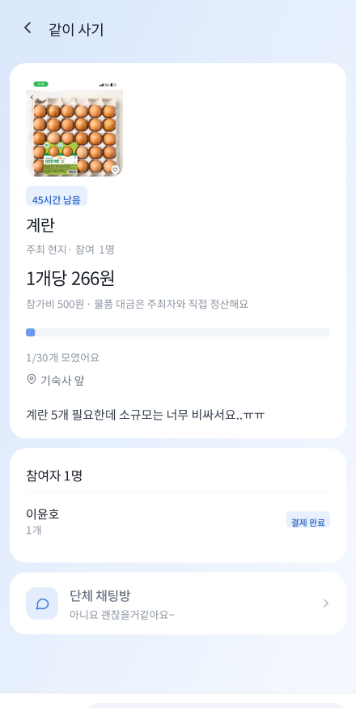 | 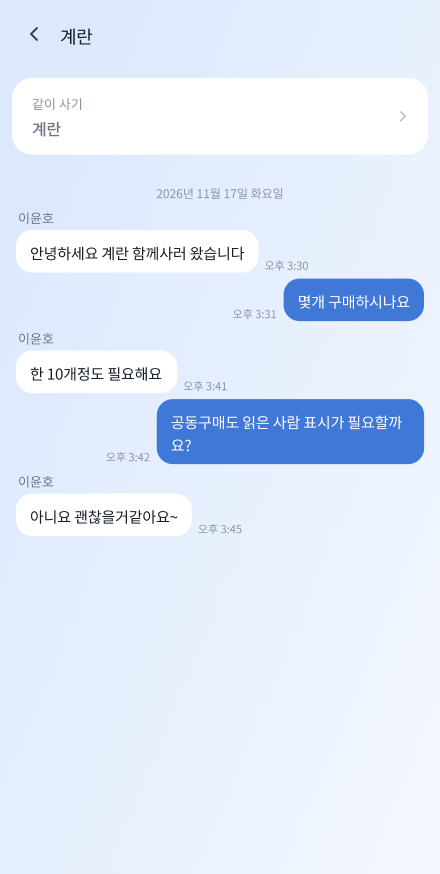 | 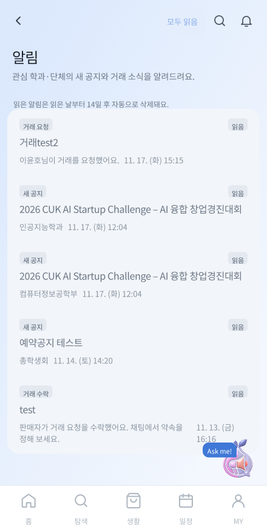 |

### 관리자

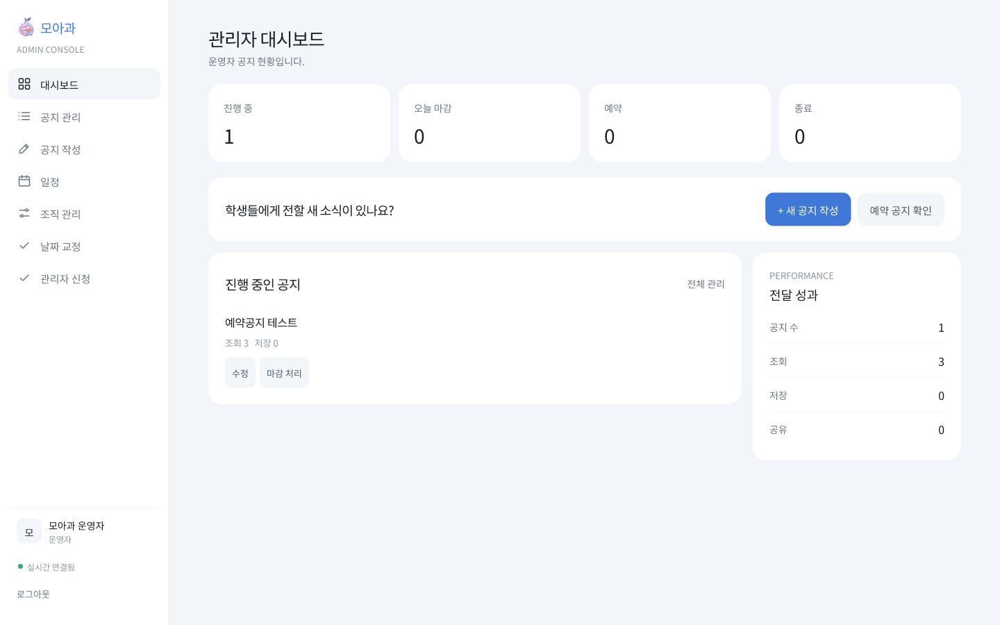

 

## 주요 기능

### 공통

| 기능명 | 기능 설명 |
| --- | --- |
| **로그인** | • 학생: Google, Kakao 소셜 로그인   • 관리자: 아이디, 비밀번호 로그인   • HttpOnly 쿠키 세션, 리프레시 토큰 자동 갱신 |
| **약관과 개인정보** | 가입 시 약관 동의 기록, 회원 탈퇴와 개인정보 파기 |
| **공지 수집** | • 학교, 학과 홈페이지 공지 주기적 크롤링(썸네일, 첨부파일 포함)   • Gemini로 마감일, 행사일, 카테고리, 키워드 추출   • 학사일정 수집 |
| **실시간 반영** | 공지 등록, 수정, 삭제를 학생 화면에 SSE로 즉시 반영 |
| **웹앱** | 홈 화면 추가(PWA), 오프라인 안내 |

### 학생

| 기능명 | 기능 설명 |
| --- | --- |
| **홈** | 학내 주요 소식, 카테고리, 나를 위한 공지, 최신 공지 |
| **공지 탐색** | • 발행 주체, 카테고리 필터와 검색 범위(전체, 제목, 내용) 선택   • 최신순, 마감 임박순, 일정순, 인기순 정렬 |
| **공지 상세** | 사진 확대와 설명, 첨부파일, 북마크, 공유, 날짜 교정 요청 |
| **일정** | 학사일정, 저장한 공지, 개인 일정을 달력으로 확인. 기간 표시와 일정별 색상 |
| **관심 설정** | 주전공 선택 시 학과와 학과 학생회 자동 등록, 관심 학과, 단체, 카테고리 기반 맞춤 피드 |
| **알림** | • 새 공지, 중요 공지, 거래, 채팅 웹 푸시(FCM)   • 저장 공지와 개인 일정 24시간 전, 행사 시작 1시간 전 리마인더   • 알림함과 수신 설정 |
| **학교 안내 챗봇** | 학교 규정과 부서 연락처를 근거로 답변, 출처 표시, 학생별 질문 한도 |

### 생활

| 기능명 | 기능 설명 |
| --- | --- |
| **재학생 인증** | 학교 이메일 인증 코드 확인 |
| **중고거래** | 물품 등록, 수정, 삭제, 찜, 거래 요청과 수락, 거절, 취소, 판매 상태 필터 |
| **같이 사기** | • 모집글 등록, 참여와 취소, 모집 마감   • 참가비 결제(토스페이먼츠 결제위젯)   • 참여 취소, 모집 취소, 목표 미달 시 자동 환불 |
| **채팅** | 거래, 같이 사기 인앱 채팅(STOMP), 읽음 표시 |
| **내 거래** | 내 물품, 찜 목록, 보낸 요청, 같이 사기 내역 |

### 관리자

| 기능명 | 기능 설명 |
| --- | --- |
| **단체 관리자 신청** | 신청서 제출 → 운영자 승인 → 비밀번호 설정 링크 발급, 반려 시 메일 안내 |
| **대시보드** | 진행 중인 공지와 마감 처리, 공지 수, 조회, 저장, 공유 성과 |
| **공지 관리** | 공지 등록, 수정, 삭제, 복제, 즉시 또는 예약 게시, 마감 처리, 알림 다시 보내기 |
| **일정** | 게시 예정, 행사 시작, 신청 마감 일정 확인 |
| **단체 정보** | 단체 소개, 공식 홈페이지와 SNS 정보 관리 |
| **운영자** | 관리자 신청 검토, 크롤링 공지 날짜 교정 검토, 운영자 공지 필수 수신 |

 

## 아키텍처

### 서비스 아키텍처

학생과 관리자는 하나의 Next.js 웹에서 접속하고, Spring Boot API가 공지, 생활 거래, 채팅, 알림을 처리함. 학교 안내 챗봇은 별도 Python 서비스로 분리해 BE가 로그인과 질문 한도를 확인한 뒤 중계함.

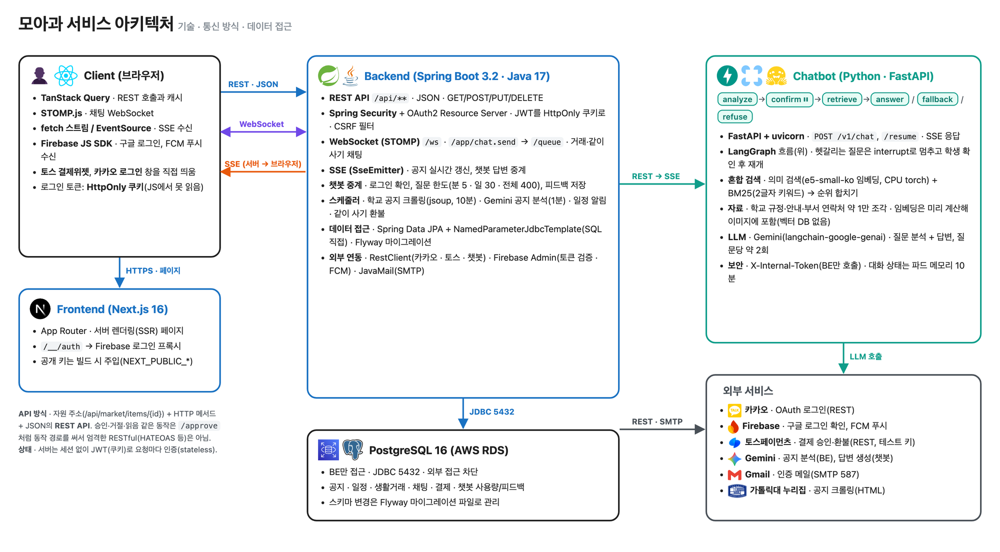

### 배포 아키텍처

AWS EC2 한 대의 k3s 클러스터에 FE, BE, 챗봇을 올리고 DB는 RDS로 분리함. `main`에 머지하면 GitHub Actions가 이미지를 GHCR에 올리고 infra 저장소의 태그를 바꾸며, Argo CD가 이를 감지해 배포함. 외부에는 80, 443 포트만 열고 노드 접속은 SSM으로만 함.

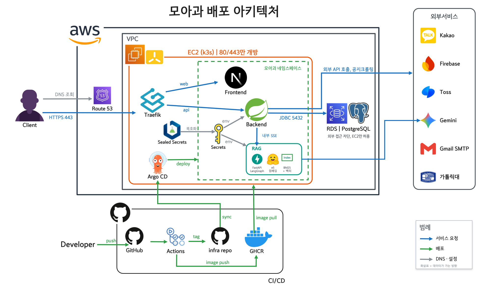

 

## 기술 스택

### FrontEnd
      

### BackEnd
       

### Chatbot, AI
    

### DB

### Infra
     

### CI/CD
   

### Test
  

 

## 저장소

| 저장소 | 역할 | 주요 내용 | 기술 |
| --- | --- | --- | --- |
| [FE](https://github.com/Moa-Gwa/FE) | 학생, 관리자 웹 | • `src/app`: 학생(홈, 탐색, 일정, 생활, MY), 관리자, 로그인과 신청 화면   • `src/components`, `hooks`, `lib`: 공통 UI, 실시간 구독, API 호출   • 푸시 서비스 워커, PWA 설정   • 단위 테스트(`tests`), Playwright E2E(`e2e`) | Next.js 16, React 19, TypeScript, Tailwind CSS |
| [BE](https://github.com/Moa-Gwa/BE) | API 서버 | • 도메인별 패키지: 인증, 공지와 피드, 관리자, 단체, 일정과 리마인더, 알림, 생활 거래, 채팅, 챗봇 중계, 날짜 교정   • 학교, 학과 홈페이지 크롤러와 Gemini 공지 정보 추출   • Flyway 마이그레이션, 통합 테스트   • local 프로필 Swagger 문서 | Spring Boot 3.2, Java 17, PostgreSQL |
| [chatbot](https://github.com/Moa-Gwa/chatbot) | 학교 안내 챗봇 | • 학교 규정, 안내, 부서 연락처 약 1만 조각 대상 RAG   • LangGraph 흐름: 질문 분석 → 확인 → 검색 → 답변 또는 근거 부족 안내   • 의미 검색(e5 임베딩)과 BM25 혼합 검색, SSE 답변 스트리밍   • 검색 품질 평가 세트(`eval`)와 테스트 | Python, FastAPI, LangGraph, Gemini |
| infra (비공개) | 운영 배포 | • Terraform: EC2, RDS, Route 53, 보안 그룹, SES   • Kustomize 매니페스트(local, prod), Sealed Secrets, cert-manager   • Argo CD 애플리케이션(GitOps) | Terraform, k3s, Argo CD |

 

## 팀원

|||
|:-:|:-:|
|이윤호 [@uknowe](https://github.com/uknowe)|김현지 [@kimhyunji24](https://github.com/kimhyunji24)|

 
